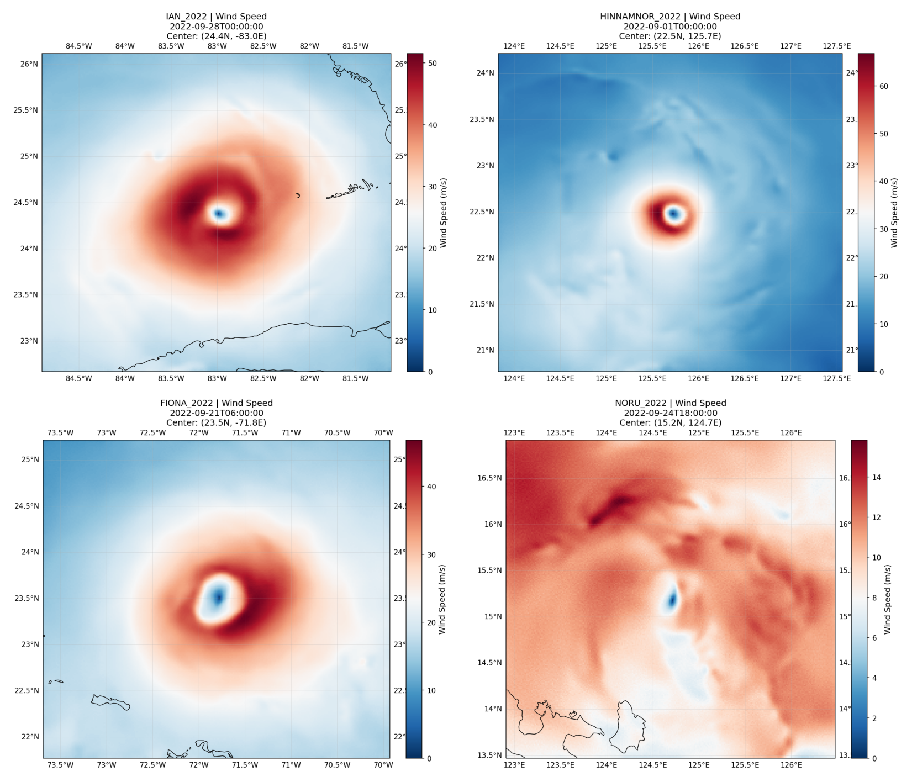

# QiFeng-CYGNSS: A Global Kilometre-Scale Tropical Cyclone Inner-Core Vector Wind Dataset

<p align="center">
  
</p>

<p align="center">
  <em>Example reconstructions: Hurricane Ian (2022), Typhoon Hinnamnor (2022), Hurricane Fiona (2022), Typhoon Noru (2022).</em>
</p>

---

## Overview

This repository provides data access tools for the **QiFeng-CYGNSS** dataset — a global kilometre-scale tropical cyclone (TC) inner-core 10 m vector wind dataset reconstructed from CYGNSS satellite observations using a physics-guided score-based diffusion assimilation framework.

The dataset is described in the companion data descriptor paper submitted to *Earth System Science Data* (Han et al., 2026a). The reconstruction methodology, validation, and ablation experiments are documented in the methodology preprint (Han et al., 2026b; [arXiv:2605.18477](https://arxiv.org/abs/2605.18477)).

**Name origin.** The name *QiFeng* (Chinese: 栖风, *qī fēng* — literally "the wind at rest") evokes the Chinese poetic image of 使风栖定，令无形之风归于完整之形 — "letting the wind settle, so that the formless wind returns to a complete form". The name reflects the dataset's purpose: gathering sparse, direction-free CYGNSS scalar observations and letting them coalesce into a structured kilometre-scale vector wind field.

**Key characteristics:**

| Property | Value |
|----------|-------|
| Spatial coverage | Storm-relative domain, 384 km × 384 km, all six active global basins (NA, EP, WP, NI, SI, SP) |
| Grid resolution | 1.5 km (256 × 256 pixels) |
| Temporal coverage | January 2020 – September 2022 |
| Number of TCs | 313 distinct IBTrACS storm IDs |
| Total snapshots | 4955 (at IBTrACS reporting times with CYGNSS coverage, primarily 6-hourly) |
| OCS-pass snapshots | 1960 (39.6 %), recommended for quantitative use |
| Variables | u10, v10 (10-m wind components), observation metadata, OCS quality flag |
| Ensemble uncertainty | 16-member pixel-level spread for 138 major-hurricane snapshots |
| Format | NetCDF-4 (CF-1.8 compliant) |
| Size | ~2.0 GB |

## Dataset Access

The full dataset is archived on Zenodo:

[](https://doi.org/10.5281/zenodo.23761581)

## File Structure

```
QiFeng_output_dataset/
├── 2022266N12294.nc             # Hurricane Ian, 2022
├── ...                          # 313 storm files named by IBTrACS SID
├── snapshot_index.csv
├── ensemble_index.csv
├── ensemble_uncertainty.nc      # 16-member wind-speed spread for 138 snapshots
├── empirical_error_model/
├── variables.csv
└── README.txt
```

Each per-TC file contains:

| Variable | Dimensions | Description |
|----------|-----------|-------------|
| `u10` | (time, y, x) | 10-m eastward wind component (m/s) |
| `v10` | (time, y, x) | 10-m northward wind component (m/s) |
| `time` | (time,) | Analysis time |
| `center_lat` | (time,) | TC center latitude (°N) |
| `center_lon` | (time,) | TC center longitude (°E) |
| `ibt_vmax` | (time,) | IBTrACS best-track Vmax (knots) |
| `n_obs` | (time,) | Number of CYGNSS observations |
| `meets_ocs` | (time,) | Observation Coverage Sufficiency flag |
| `obs_wind_speed` | (time, n_obs_max) | CYGNSS wind speed per specular point |
| `obs_pixel_i` | (time, n_obs_max) | Observation pixel row on the 256×256 grid |
| `obs_pixel_j` | (time, n_obs_max) | Observation pixel column on the 256×256 grid |

For basin and intensity comparisons, match the storm ID and analysis time to the IBTrACS `BASIN` and `USA_WIND` fields.

## Quick Start

### Read a NetCDF file

```python
import xarray as xr
import numpy as np

ds = xr.open_dataset('2022266N12294.nc')

# Pick a single snapshot
t = '2022-09-28T00:00:00'
u10 = ds['u10'].sel(time=t).values   # (256, 256) in m/s
v10 = ds['v10'].sel(time=t).values
ws  = np.sqrt(u10**2 + v10**2)

ocean = ds['land_mask'].sel(time=t).values == 0
ocs = ds['meets_ocs'].sel(time=t).item()
print(f"SID: {ds.sid.item()}, OCS-pass: {ocs}, Ocean peak: {np.nanmax(ws[ocean]):.1f} m/s")

# Wind-speed spread for the same storm and analysis time
# ens = xr.open_dataset('ensemble_uncertainty.nc')
# match = (ens.sid.values == ds.sid.item()) & (ens.time.values == np.datetime64(t))
# spread = ens.ws_spread.isel(record=match)
```

### Export to GeoTIFF

```bash
python export_tiff.py --input /path/to/dataset/ --output ./tiff_export/
```

See [`export_tiff.py`](export_tiff.py) for batch conversion of NetCDF snapshots to multi-band GeoTIFF (u10, v10, wind_speed).

### Visualization notebook

[`visualize_dataset.ipynb`](visualize_dataset.ipynb) demonstrates how to:
- Load a per-TC NetCDF file
- Convert the storm-relative grid to geographic coordinates
- Plot the wind speed field at peak intensity
- Filter snapshots by the OCS quality flag

## Grid Convention

- The grid is **storm-centric Cartesian**: pixel (128, 128) is the interpolated TC center.
- Row index increases **southward**, column index increases **eastward**.
- The `latitude` and `longitude` variables give the geographic coordinates of each grid cell.
- The `meets_ocs` flag indicates whether observation coverage is sufficient for reliable reconstruction. All three of the following criteria must be met: (a) number of CYGNSS observations `n_obs ≥ 300`; (b) inner-core spatial coverage of at least seven occupied 25 km cells within 100 km of the TC centre; (c) azimuthal coverage fraction `az_cov ≥ 0.625` (≥ 5 out of 8 azimuthal octants containing observations within 144 km).

## Validation summary

Independent validation on the OCS-pass subset against high-resolution reference observations:

| Reference | Cases | Pixel-level wind speed RMSE |
|-----------|-------|----------------------------|
| C-band SAR | 45 overpasses | 6.41 m s⁻¹ |
| Airborne Tail Doppler Radar | 23 snapshots | 6.9 m s⁻¹ |

Across the 1732 OCS-pass snapshots with valid intensities for all three products, maximum-wind RMSE against IBTrACS is 8.2 m s⁻¹ for QiFeng, 12.7 m s⁻¹ for ERA5 and 11.2 m s⁻¹ for CCMP.

## Requirements

```
numpy
xarray
netCDF4
matplotlib
rasterio        # for GeoTIFF export only
```

Tested with Python 3.10.

## Citation

If you use this dataset, please cite the data descriptor paper, the methodology preprint, and the Zenodo record:

```bibtex
@article{han2026qifeng,
  title={A global kilometre-scale tropical cyclone inner-core vector wind field dataset from CYGNSS observations},
  author={Han, Xinhai and Li, Xiaohui and Yang, Jingsong and Ni, Hanyue and Niu, Zeyi and Huang, Wei},
  journal={Earth System Science Data},
  year={2026},
  note={in review}
}

@article{han2026method,
  title={Global kilometre-scale tropical cyclone inner-core vector winds from sparse scalar {CYGNSS} observations},
  author={Han, Xinhai and Li, Xiaohui and Yang, Jingsong and Niu, Zeyi and Han, Guoqi and Wang, Jiuke and Huang, Wei and Zheng, Yunxia and Ni, Hanyue and Wang, Yiqi and Tao, Wei and Aouf, Lotfi and Peng, Shaoliang and Chen, Dake},
  journal={arXiv preprint arXiv:2605.18477},
  year={2026},
  doi={10.48550/arXiv.2605.18477}
}

@misc{han2026dataset,
  title={{QiFeng-CYGNSS}: A Global Kilometre-Scale Tropical Cyclone Inner-Core Vector Wind Field Dataset (v1.1)},
  author={Han, Xinhai and Li, Xiaohui and Yang, Jingsong and Ni, Hanyue and Niu, Zeyi and Huang, Wei},
  year={2026},
  publisher={Zenodo},
  doi={10.5281/zenodo.23761581},
  note={CC BY 4.0}
}
```

## License

This dataset is distributed under [CC BY 4.0](https://creativecommons.org/licenses/by/4.0/). The accompanying access/visualization code in this repository is released under the MIT License.

## Permanent archive

The scripts and notebooks in this repository are also deposited together with the dataset on Zenodo (same record, single DOI), which serves as the permanent archive:

[10.5281/zenodo.23761581](https://doi.org/10.5281/zenodo.23761581)

This GitHub repository is kept as a development copy and may receive minor updates between dataset releases. When citing a specific code state, please refer to the Zenodo record.
